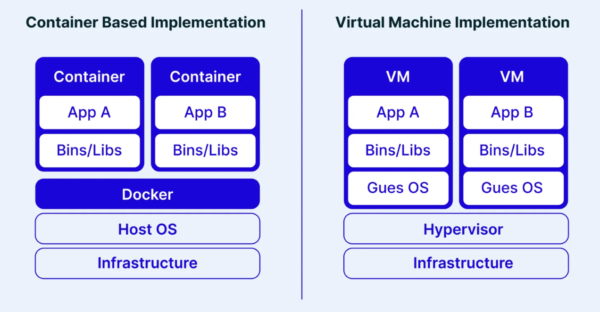
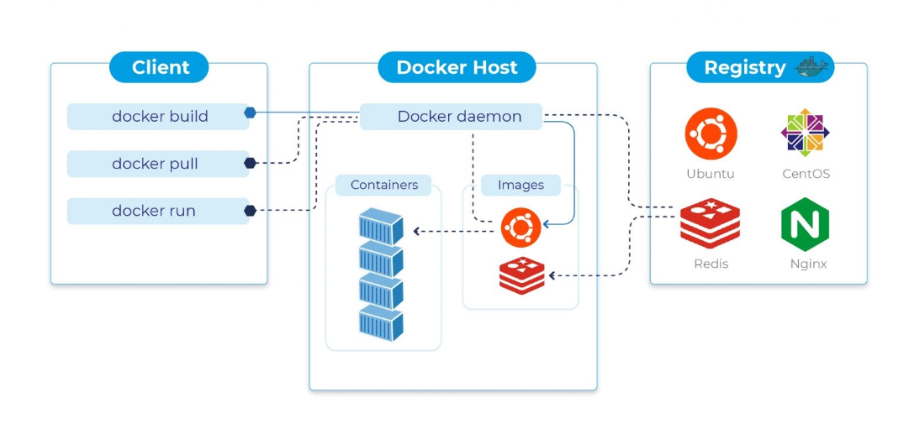
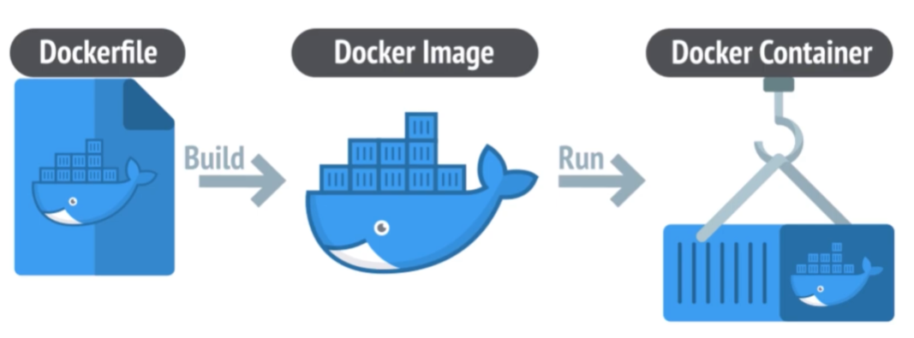

## 1. Docker là gì

Docker là một nền tảng cung cấp các công cụ và dịch vụ cho phép đóng gói ứng dụng cùng toàn bộ môi trường chạy (runtime, thư viện, file cấu hình) thành một đơn vị duy nhất gọi là **Container**

Triết lý cốt lõi của Docker là **"Build once, run anywhere"** — ứng dụng khi đã đóng gói trong container có thể chạy nhất quán trên bất kỳ đâu: máy tính cá nhân, server nội bộ, hay hạ tầng Cloud

## 2. Phân biệt Containerization và Virtualization

|        Tiêu chí         |                    Máy ảo (VMware / KVM)                    |                        Docker Container                         |
| :---------------------: | :---------------------------------------------------------: | :-------------------------------------------------------------: |
|      Mức độ cô lập      |                  Mức Phần cứng & Hệ thống                   |                         Mức Tiến trình                          |
|      Hệ điều hành       |        Mỗi VM bắt buộc phải chạy một Guest OS riêng         |                  Dùng chung Kernel của Host OS                  |
|    Cơ chế hoạt động     | Thông qua Hypervisor để giả lập phần cứng (CPU, RAM, Disks) | Dùng Namespaces và Cgroups giới hạn tài nguyên của Linux Kernel |
|    Tốc độ khởi động     |                 Hàng chục giây đến vài phút                 |                    Vài miligiây đến 1–2 giây                    |
| Dung lượng & Tài nguyên |           Tốn hàng GB RAM/Ổ cứng để nuôi Guest OS           |     Siêu nhẹ (vài chục MB đến vài trăm MB), tốn rất ít RAM      |

## 3. Kiến trúc của Docker

- **Docker Client (`docker` CLI):** Công cụ dòng lệnh để người dùng nhập lệnh.

- **Docker Host (Docker Server):** Máy chủ chạy tiến trình nền **Docker Daemon (`dockerd`)**. Daemon chịu trách nhiệm trực tiếp lắng nghe lệnh từ Client, tải Image, tạo và quản lý Container, Volume, Network.

- **Docker Registry:** Kho lưu trữ Images (tiêu biểu là Docker Hub).

## 4. Các thành phần trong Docker

- **Dockerfile**: Là một tệp văn bản không có phần mở rộng, chứa các câu lệnh theo thứ tự để Docker tự động xây dựng nên một Docker Image

- **Docker Image:** Bản thiết kế (template chỉ đọc) chứa mã nguồn, môi trường chạy, thư viện và file cấu hình.

- **Docker Container:** Một instance đang chạy được khởi tạo từ Image. Mang tính chất tạm thời (stateless) và có thể chạy nhiều Container từ 1 Image

- **Docker Volume:** Thư mục lưu trữ dữ liệu vĩnh viễn nằm ngoài container (được Docker quản lý tại `/var/lib/docker/volumes/`). Dữ liệu trong Volume không bị mất khi container dừng hoặc bị xóa.

- **Bind Mounts:** Cơ chế gắn trực tiếp một thư mục/file từ máy thật vào container. Thường dùng trong môi trường **Development** để live-reload code.

- **Docker Network:** Mạng ảo giúp các container trong cùng network có thể giao tiếp với nhau qua **Tên Service / Tên Container** nhờ cơ chế DNS nội bộ.
